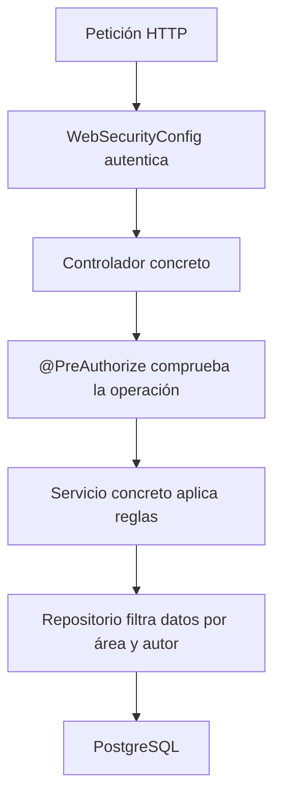

# Plan de refactorización de servicios controladores y permisos

El objetivo es que cada ruta de Optifactory declare sus operaciones en un controlador concreto y delegue en un servicio concreto. Spring Security decidirá quién puede ejecutar cada operación mediante `@PreAuthorize`. Los repositorios y servicios conservarán las reglas de acceso a datos por **área y autor** con consultas y comprobaciones explícitas. Al terminar, se eliminarán las cuatro clases base del CRUD y `AlcancePermiso`.

Este plan parte de P4 y afecta al backend completo porque las clases base se comparten entre los recursos de todas las divisiones. Mantén los contratos HTTP, las reglas de la [matriz de permisos](MATRIZ_PERMISOS.md) y el comportamiento ya probado en [#89](https://github.com/Matiasnm14/optifactory/issues/89) y [#154](https://github.com/Matiasnm14/optifactory/issues/154).

## Estructura objetivo

| Ubicación | Responsabilidad |
| --- | --- |
| `optifacotry-api/config/WebSecurityConfig.java` | Configurar un `SecurityFilterChain` para autenticación y acceso HTTP, conservar el flujo CSRF y habilitar seguridad por método con `@EnableMethodSecurity`. Mantener las rutas HTTP con su nivel de acceso actual. |
| `optifacotry-api/controller` | Declarar explícitamente cada método HTTP, sus parámetros, validación de entrada y respuesta. Inyectar el servicio del recurso. |
| `core/service` | Declarar `@PreAuthorize` en los métodos públicos de los servicios concretos que sirven peticiones. Resolver las reglas de negocio, verificar el alcance de los cambios y delimitar transacciones. |
| `data/repository/repos` | Hacer consultas por ID, listados y agregados que apliquen el ámbito autorizado antes de paginar, contar o sumar. Usar consultas JPA explícitas o especificaciones propias del recurso. |

Mantén `optifacotry-api → core → data`. Los controladores y servicios serán clases concretas sin herencia de CRUD ni interfaces propias. Conserva las interfaces de repositorios Spring Data y el modelo JPA. Si hay lógica repetida, reutiliza una función o componente pequeño con una responsabilidad clara y úsalo por composición.



## Configuración de autorización

1. Habilita `@EnableMethodSecurity` en `WebSecurityConfig`. Conserva la autenticación existente y el endpoint `GET /api/v1/csrf`. Usa la cadena HTTP como primera barrera y las anotaciones de los servicios para la regla de rol de cada operación. Evita repetir esa misma regla en el controlador. [Autorización HTTP](https://docs.spring.io/spring-security/reference/7.1/servlet/authorization/authorize-http-requests.html) · [Seguridad por método](https://docs.spring.io/spring-security/reference/7.1/servlet/authorization/method-security.html)
2. Reutiliza [PermisosService](../../core/src/main/java/edu/upb/optifacotry/service/PermisosService.java) como fuente de identidad activa, roles vigentes y áreas. Agrega un método de autorización como `tieneAlgunRol(String... codigos)` para usarlo desde `@PreAuthorize`. Ese método debe exigir una cuenta activa e inequívoca y leer los roles vigentes de PostgreSQL. Así el retiro de un rol tiene efecto en la siguiente petición sin cambiar el mecanismo de autenticación. Usa `hasRole(...)` solo si los roles de base de datos pasan a cargarse como autoridades de Spring y se preserva la revocación.
3. Anota el método público invocado por el controlador a través del bean de Spring. Si un método de la misma clase llama a otro, esa llamada interna no pasa por el interceptor de `@PreAuthorize`. La operación pública debe proteger el flujo completo. Mantén el aprovisionamiento del administrador inicial como un camino interno del arranque, con la configuración que ya existe. [Proxies de Spring](https://docs.spring.io/spring-framework/reference/core/aop/proxying.html) · [Configuración del administrador inicial](../../optifacotry-api/src/main/java/edu/upb/optifacotry/config/AdministradorInicialConfiguration.java)
4. Verifica que cada handler HTTP esté cubierto por una operación protegida. Para las excepciones de negocio, como registrar un reporte sin un rol específico o consultar reportes propios, exige una identidad autenticada y aplica la comprobación de cuenta activa, autor y área que corresponda.

Ejemplo para el piloto. Los nombres de los métodos son propuestos.

```java
@PreAuthorize("@permisosService.tieneAlgunRol('PERSONAL', 'SUPERVISION_PRODUCCION')")
@Transactional(readOnly = true)
public Page<PersonaResponseDto> listar(Pageable pageable) {
    var actor = permisosService.actorActual();
    return personaRepository.buscarVisibles(actor.areas(), pageable).map(this::toResponse);
}
```

La anotación permite ejecutar `listar`. La consulta `buscarVisibles` determina qué filas se pueden devolver y contar. En la implementación, reutiliza el contexto de autorización durante la petición si se detectan lecturas duplicadas de los mismos roles. Mantén la vigencia de los roles entre peticiones.

## Reglas que reemplazan a AlcancePermiso

| Caso | Comportamiento que debe conservarse |
| --- | --- |
| Personal y datos asociados | Usar el área explícita de la persona cuando existe. Si falta, usar las áreas de la cuenta vinculada y exigir que todas estén autorizadas. Si el recurso exige un área y carece de una, queda fuera del alcance. Aplicar la misma regla a los períodos y vigencias de capacitación. |
| Registros con varias relaciones de área | Comprobar cada área presente que exige la regla actual. Por ejemplo, una inspección puede vincular una orden y un lote. Si están ambos, una relación autorizada no concede acceso a la otra. |
| Reportes y adjuntos | `SEGURIDAD_INDUSTRIAL` consulta reportes dentro de sus áreas. El resto de usuarios autorizados por la regla actual consulta solo los que registró y que están dentro de su área. Para servir una imagen, comprobar también que el adjunto pertenezca al reporte indicado. |
| Listado, detalle y totales | Pasar el filtro de alcance a la consulta JPA. El listado, `totalElements` y los agregados deben trabajar sobre el mismo conjunto autorizado. En el detalle, conservar el `404` de un ID ajeno al alcance cuando el actor está habilitado para consultar el recurso. |
| Creación, edición y eliminación | Para crear, comprobar el alcance del registro que se va a guardar. Para editar, verificar el registro actual y el resultado del cambio en la misma transacción. Para eliminar, verificar el alcance antes de borrar. Conservar las transacciones y los bloqueos que protegen la concurrencia. |
| Catálogos y endpoints especiales | Conservar los permisos de catálogo globales donde la política actual los define. Los recursos que solo permiten lectura o comandos específicos deben conservar esas operaciones. En particular, roles, auditoría, reportes y adjuntos tienen rutas que no equivalen a un CRUD completo. |

La equivalencia se revisa contra [PoliticaPermisos](https://github.com/Matiasnm14/optifactory/blob/51d33f27816dd2280466b979469a148f5e72ec96/core/src/main/java/edu/upb/optifacotry/service/PoliticaPermisos.java) y [AlcancePermiso](https://github.com/Matiasnm14/optifactory/blob/51d33f27816dd2280466b979469a148f5e72ec96/core/src/main/java/edu/upb/optifacotry/service/AlcancePermiso.java) antes de retirar el código anterior. Declara las relaciones en las consultas de cada recurso e implementa validaciones Java con entidades concretas para las escrituras que lo requieran. Esto permite eliminar los recorridos dinámicos de propiedades y la doble interpretación genérica de las rutas.

## Orden de implementación

1. **Levantar el inventario y la línea base.** Identifica todos los usos directos e indirectos de `CrudService`, `ReadOnlyCrudService`, `CrudController`, `ReadOnlyCrudController` y `AlcancePermiso`. Para cada recurso, registra rutas, verbos, roles, alcance, códigos HTTP y operaciones especiales. Ejecuta `./mvnw -B -ntp verify` con PostgreSQL mediante Testcontainers y guarda el resultado de partida.
2. **Migrar un flujo completo de personal.** Empieza por `PersonaController` y `PersonaService`, y sigue con `PeriodoPersonal` y `PersonaCapacitacion`. Incorpora `WebSecurityConfig`, activa `@PreAuthorize` y escribe consultas de alcance propias. Confirma que las pruebas cubren a un actor de otra área, una persona sin cuenta, la prioridad del área explícita y un cambio de área denegado. Conserva las clases base mientras otros recursos aún las usan.
3. **Migrar por grupos de recursos.** Lleva el contrato HTTP y el control de permisos de cada recurso al patrón nuevo en el mismo cambio. Cada grupo debe compilar y mantener sus pruebas antes de continuar.
   - **Cuentas, catálogos y auditoría.** Mantén asignación y retiro de roles por comandos, historial de solo lectura y aprovisionamiento inicial. Migra también los catálogos con permisos globales.
   - **Seguridad industrial.** Migra reportes, adjuntos y acciones. Comprueba la consulta de listados y adjuntos por área y autor, la descarga de imágenes y el registro de acciones.
   - **Consumos y residuos.** Conserva filtros y totales de consumo, historial de seguimiento de residuos y sus operaciones específicas. Revisa las consultas de agregado y los bloqueos transaccionales.
   - **Resto de recursos.** Migra calidad, órdenes, mantenimiento, inventario, integraciones y los demás recursos del inventario. Valida los recursos con referencias a varias áreas y coordina con las otras divisiones cuando una ruta tenga cambios recientes.
4. **Retirar la infraestructura anterior.** Cuando no queden consumidores, elimina `CrudService`, `ReadOnlyCrudService`, `CrudController`, `ReadOnlyCrudController` y `AlcancePermiso`, incluidos sus records auxiliares. Trasladadas las reglas de rol y alcance, elimina las partes sin uso de `PoliticaPermisos` y sus auxiliares. Revisa imports, anotaciones y enlaces de la documentación que todavía apunten a esas clases.

## Validación para dar el refactor por terminado

- Ejecutar `./mvnw -B -ntp verify` y conservar la cobertura de la [suite de integración](../../optifacotry-api/src/test/java/edu/upb/optifacotry/OptifacotryApplicationTests.java). La prueba de personal debe ejercitar el controlador y el servicio a través de Spring, con roles asignados en PostgreSQL.
- Comprobar al menos una operación por tipo de permiso. Cubrir actor sin autenticar, cuenta inactiva, rol insuficiente o retirado, área ajena, autor distinto y registros sin área. Verificar que los listados, totales y agregados excluyan datos ajenos.
- Verificar una edición que intenta mover un registro de un área autorizada a otra no autorizada, un recurso con varias áreas y la creación de un reporte que deriva el actor del usuario autenticado.
- Revisar el inventario de rutas y su contrato. Las rutas de solo lectura conservan el rechazo de escrituras. Las operaciones de roles conservan su auditoría y las de descarga mantienen la comprobación del reporte, el adjunto y el área.
- Confirmar que no queden clases abstractas de servicios o controladores ni referencias Java a `AlcancePermiso`, `CrudService`, `ReadOnlyCrudService`, `CrudController` o `ReadOnlyCrudController`.

En cada entrega, deja el grupo migrado, las rutas verificadas, las clases que aún usan el patrón anterior y el resultado de las pruebas. El siguiente grupo se toma cuando el anterior conserva sus permisos y contratos.
